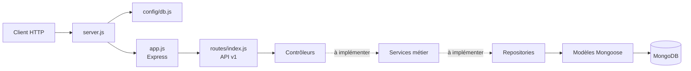

# Architecture de l'API ToolShare

## Vue d'ensemble

ToolShare est un backend REST en Node.js, Express 5, Mongoose et MongoDB.
L'architecture est initialisée dans `src/`. Les routes racine, santé et
d'authentification fonctionnent; les modules des ressources métier sont des
points de départ et ne fournissent pas encore de CRUD.



## Structure du backend

```text
src/
  app.js
  server.js
  config/
    db.js
    swagger.js
  models/
    user.model.js
    store.model.js
    tool.model.js
    reservation.model.js
    installation.model.js
  repositories/
    user.repository.js
    store.repository.js
    equipment.repository.js
    reservation.repository.js
    installation.repository.js
  services/
    auth.service.js
    installation.service.js
    store.service.js
    equipment.service.js
    reservation.service.js
  controllers/
    auth.controller.js
    installation.controller.js
    store.controller.js
    equipment.controller.js
    reservation.controller.js
    root.controller.js
    health.controller.js
  routes/
    index.js
    v1/index.js
    auth.routes.js
    installation.routes.js
    store.routes.js
    equipment.routes.js
    reservation.routes.js
  middlewares/
    auth.middleware.js
    role.middleware.js
    store-access.middleware.js
    validate.middleware.js
    error.middleware.js
  utils/
    jwt.util.js
tests/
  unit/
  integration/
```

Les schémas User, Store, Tool et Reservation sont définis. Le diagramme UML
nomme la ressource `Tool`; le module HTTP `equipment` l'expose sous
`/api/v1/tools`.

## Requêtes HTTP disponibles

| Méthode | Chemin | Réponse |
| --- | --- | --- |
| `GET` | `/` | Message de bienvenue et environnement |
| `GET` | `/api/v1/health` | État `ok` et environnement |
| `POST` | `/api/v1/auth/register` | Crée le premier compte comme `ADMIN` sans authentification si aucun utilisateur n'existe; ensuite, `MANAGER` ou `ADMIN` requis |
| `POST` | `/api/v1/auth/login` | Vérifie les identifiants et retourne un JWT |
| `GET` | `/api/v1/auth/` | Liste les utilisateurs; authentification `MANAGER` ou `ADMIN` requise |
| `DELETE` | `/api/v1/auth/` | Supprime tous les utilisateurs; authentification `ADMIN` requise |
| `GET` | `/api/v1/me` | Retourne le profil associé au JWT Bearer |

Les routeurs `/api/v1/auth`, `/installation`, `/stores`, `/tools` et
`/reservations` sont montés.

Les endpoints `/api/v1/tools` requièrent un rôle `ADMIN` ou `MANAGER`.
Les gestionnaires ne peuvent consulter et modifier que les matériels de leur
magasin affecté. `GET /api/v1/tools` accepte les filtres `storeId`, `status`
et `includeDisabled`; le filtre `storeId` est réservé à l'ADMIN.
La désactivation est logique (`isActive: false`). Le statut métier accepte
`DISPONIBLE`, `INDISPONIBLE` ou `HORS_SERVICE`.

Les emprunts en cours et les retours sont accessibles sous
`/api/v1/reservations` :

| Méthode | Chemin | Accès et comportement |
| --- | --- | --- |
| `GET` | `/api/v1/reservations/overdue` | `MANAGER`; liste les réservations `EN_COURS` dont `endDate` est dépassée, limitées à son magasin. |
| `PATCH` | `/api/v1/reservations/:id/checkout` | `MANAGER`; remet le matériel d'une réservation `CONFIRMEE`, enregistre la date réelle et passe la réservation à `EN_COURS`. Un matériel déjà emprunté ou indisponible ne peut pas être remis. |
| `PATCH` | `/api/v1/reservations/:id/checkin` | `MANAGER`; attend `{"returnCondition":"BON"}` ou `{"returnCondition":"ENDOMMAGE"}` pour terminer un emprunt en cours et enregistrer son heure réelle de retour. Un matériel endommagé devient `INDISPONIBLE`; un matériel rendu en bon état redevient `DISPONIBLE`. |

La remise et le retour mettent à jour la réservation et l'état du matériel
dans une transaction MongoDB. Les routes vérifient que le gestionnaire est
affecté au magasin concerné.

## Démarrage et configuration

`server.js` charge `.env`, attend la connexion MongoDB, puis démarre le serveur
HTTP. Une absence de `MONGO_URI` ou un échec de connexion empêche le démarrage
et est signalé dans la console.

| Variable | Usage |
| --- | --- |
| `PORT` | Port HTTP, `5000` par défaut. |
| `NODE_ENV` | Environnement retourné par les routes de base. |
| `MONGO_URI` | URI de connexion Mongoose. L'exemple Docker cible le service `mongodb`. |
| `JWT_SECRET` | Clé obligatoire pour signer et vérifier les JWT. |

Ne créez pas de fichier `.env` contenant des secrets dans Git. Copiez
`.env.example` en `.env` localement. Démarrez les services avec :

```sh
docker compose -f docker-compose.yml up --build
```

La spécification OpenAPI est exposée sur `/api-docs.json` et l'interface
Swagger UI sur `/api-docs/`. Les opérations protégées utilisent un JWT Bearer;
utilisez **Authorize** dans l'interface pour envoyer le token.

L'inscription attend `name`, `email` et `password` (8 caractères minimum), et
nécessite un JWT Bearer d'un compte `MANAGER` ou `ADMIN`. Un `MANAGER` peut
uniquement créer des comptes `USER`; un `ADMIN` peut créer des comptes `USER`
ou `MANAGER`. Si le rôle demandé est omis, il est attribué à `USER`. Le mot de
passe est haché avec bcrypt. La connexion MongoDB de l'exemple utilise la base
`toolshare`.
Pour lire le profil, envoyer `Authorization: Bearer <token>`. Les JWT expirent
après une heure.

## Responsabilités des couches

- **Routes** : associent les chemins HTTP aux handlers.
- **Middlewares** : validation, authentification, autorisation et erreurs.
- **Contrôleurs** : traduisent HTTP vers les appels applicatifs.
- **Services** : portent les règles métier et les orchestrations.
- **Repositories** : effectuent les requêtes Mongoose.
- **Models** : définissent les schémas persistés.

Les fonctionnalités métier doivent être ajoutées couche par couche, avec des
tests unitaires et d'intégration dans `tests/`.

Les tests unitaires Jest se lancent avec `npm run test:jest`; les tests du
runner Node existant se lancent avec `npm test`.
